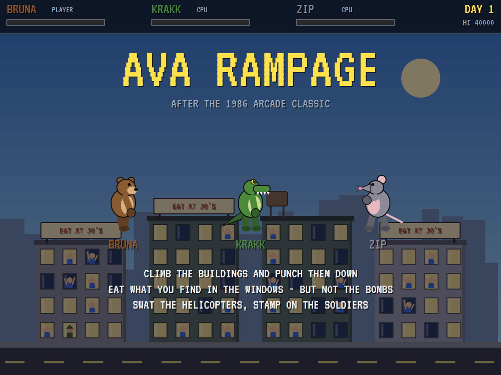
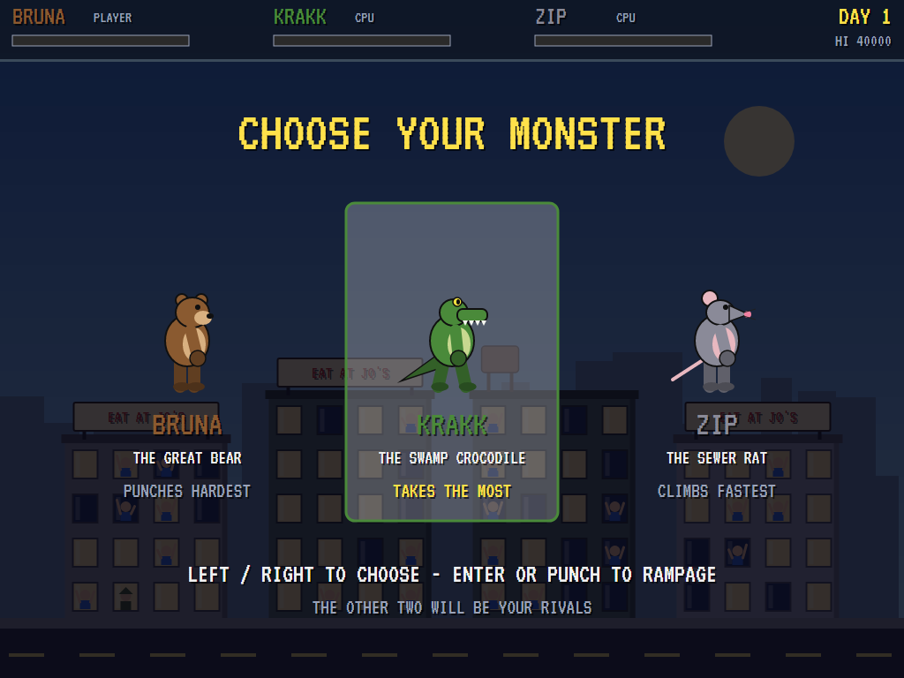
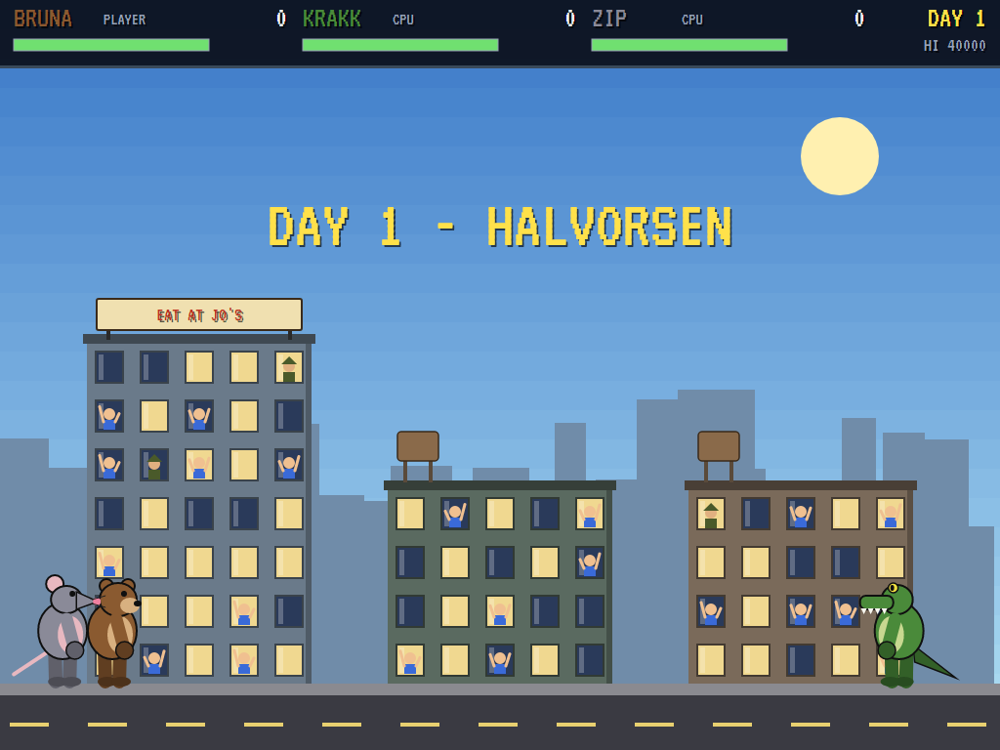
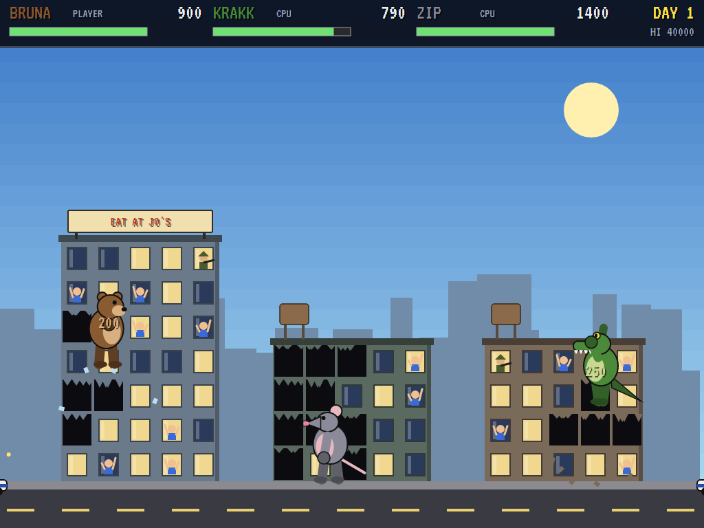
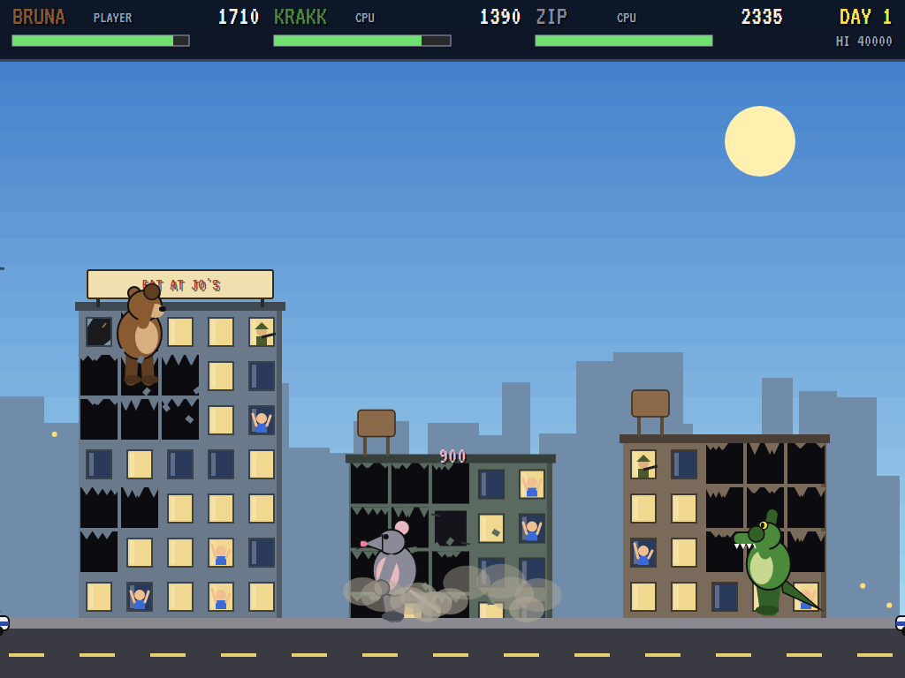
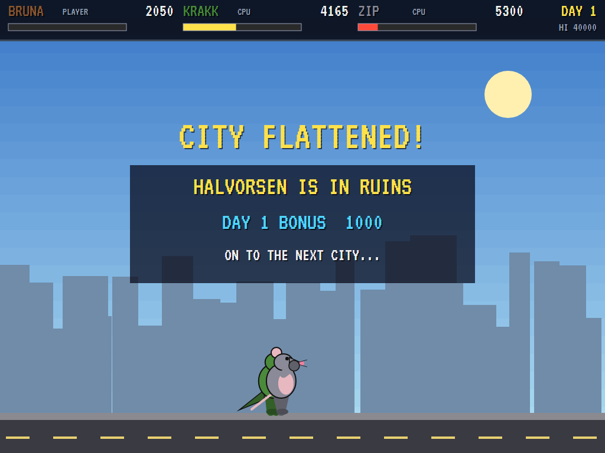
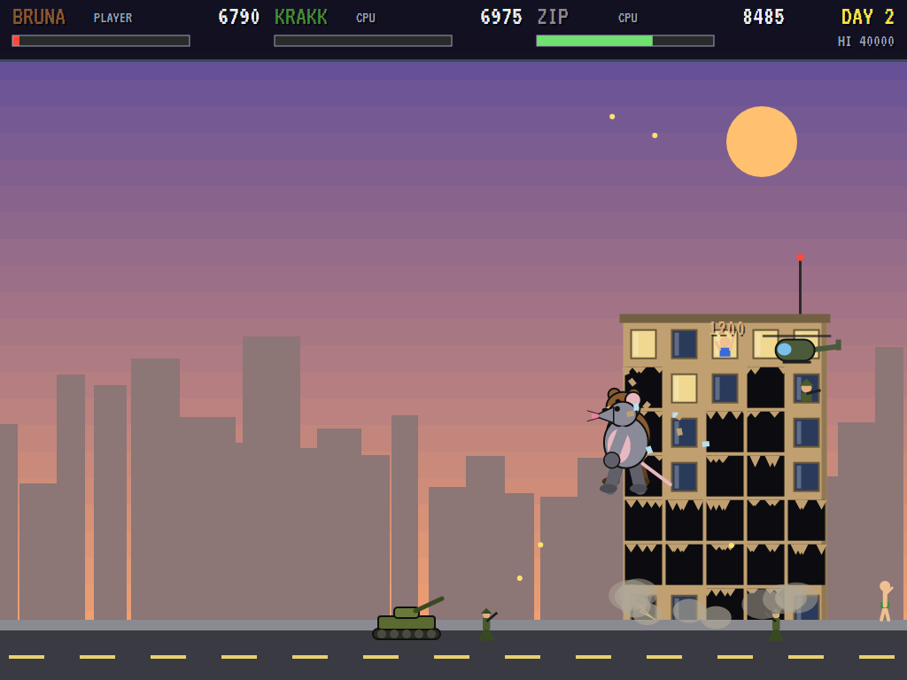
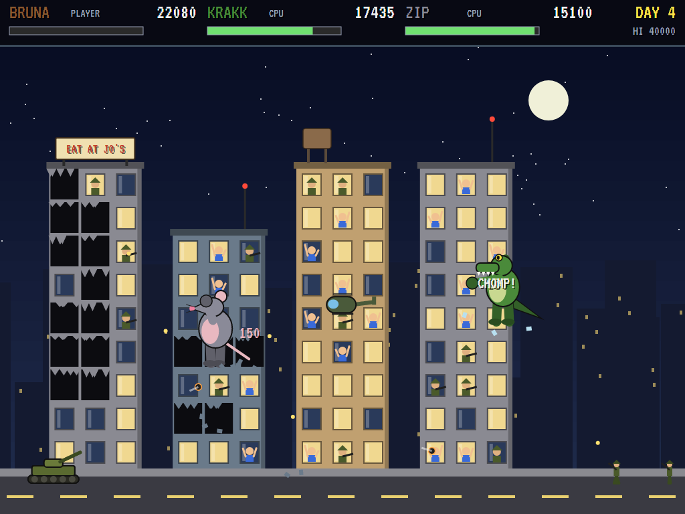
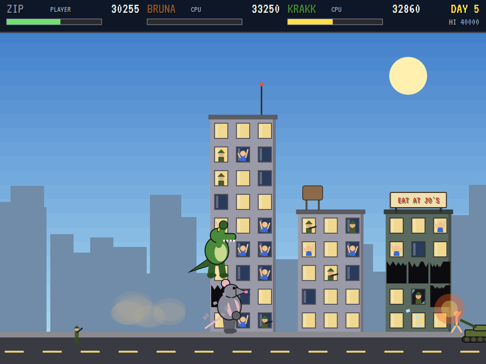
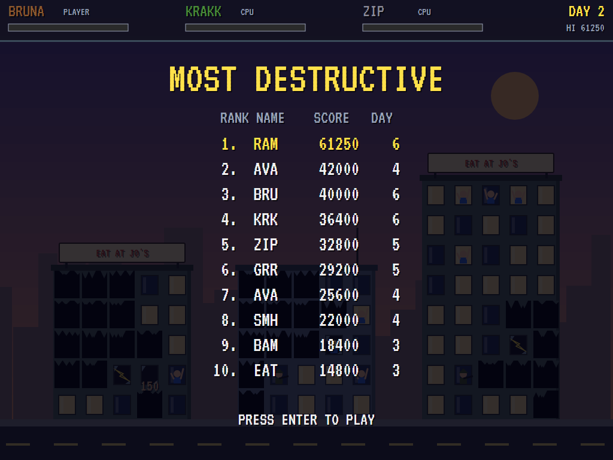

# AVA Rampage

[](https://github.com/Harlock123/AVARampage/actions/workflows/build.yml)

A city-smashing monster game in the style of Bally Midway's 1986 arcade game **Rampage**, built with
.NET 10 and Avalonia UI. Choose one of three giant monsters, climb the buildings and punch them
down, and eat whoever you find in the windows. The army will try to stop you. Flatten every building
to finish the day, then move on to the next city.

## Features

- **Three monsters**, each with its own gift. The two you don't choose are your rivals, played by the computer:
  - **Bruna**, the great bear: her punches do twice the damage.
  - **Krakk**, the swamp crocodile: his hide takes the least harm.
  - **Zip**, the sewer rat: he climbs and runs fastest, but he's the most fragile.
- **The city**: a new one every day (Halvorsen, Pike City, Grimsport and more), with more and taller buildings as the days go on.
  - Each building has water towers, antennas or billboards on the roof and floors of windows down the front.
  - The days pass through morning, a dusky afternoon, sunset and night.
- **Climbing and smashing**:
  - Climb any wall and walk along the roofs. Jump from roof to roof, or catch hold of a wall as you fall past.
  - A punch breaks the glass first and then the wall. Punch up, down or sideways.
  - Knock out enough of a building and it shakes and sinks into the street in a cloud of dust, taking anyone on it down too.
- **The windows**:
  - **People** wave for help. Eat them for health and points.
  - **Food** heals, **money** and **televisions** score.
  - **Bombs** explode and **live wires** shock you. You can't see what's behind the glass until it breaks.
  - **Soldiers** lean out and shoot at monsters close by.
- **The army**:
  - **Soldiers** march in and fire. Stamp on them.
  - **Police cars** race up with sirens and shoot.
  - **Tanks** arrive from the second day and lob shells.
  - **Helicopters** hover and strafe. It takes two punches to bring one down (one of Bruna's).
- **Health and lives**: everything hurts a little. When your health runs out, your monster shrinks back into a small, embarrassed person and runs off. You have three lives.
- **Sound**: an original stomping boogie, and sounds for the punches, breaking glass, falling masonry, chomping, burping, roaring, guns, shells, explosions, sirens and the helicopters. All mixed by OpenAL.
- **Attract mode**: leave the title alone for 15 seconds and all three monsters rampage on their own.
- **A top-ten high-score table** with arcade-style initials entry; it records the day reached.
- **Gamepads** through SDL2, as well as the keyboard.
- **Any window size**: the screen scales to fit, letterboxed. **Ctrl+S** saves a screenshot.
- **One self-contained executable** per platform: Windows, macOS and Linux on Intel/AMD and ARM.

## Screenshots

| The title | Choose your monster | Day one |
|:---------:|:-------------------:|:-------:|
|  |  |  |
| Bruna, Krakk and Zip. | The other two become your rivals. | Stomping into Halvorsen. |

| Climbing | Down it comes | The day's tally |
|:--------:|:-------------:|:---------------:|
|  |  |  |
| Three monsters on three buildings, and a sniper at the window. | A building sinking into its own dust. | Halvorsen is in ruins. |

| The army | Night | Only human |
|:--------:|:-----:|:----------:|
|  |  |  |
| A tank, soldiers and a helicopter at sunset. | Day four, and the windows full of soldiers. | Out of health, a monster shrinks and runs. |

| Most destructive | | |
|:----------------:|:-:|:-:|
|  | | |
| The high-score table. | | |

The screenshots are made by the tests, which play the game in a real (headless) window; see
[Tests](#tests).

## Download and run

Ready-to-run builds for Windows, macOS and Linux, on both Intel/AMD and ARM, are on the
[Releases page](https://github.com/Harlock123/AVARampage/releases/tag/latest). **Latest build** is
rebuilt on every push to `main`. Each download is one self-contained executable: no .NET install is
needed.

| Platform | Archive |
|---|---|
| Windows | `AVARampage-win-x64.zip`, `AVARampage-win-x86.zip`, `AVARampage-win-arm64.zip` |
| macOS | `AVARampage-osx-arm64.tar.gz` (Apple silicon), `AVARampage-osx-x64.tar.gz` (Intel) |
| Linux | `AVARampage-linux-x64.tar.gz`, `AVARampage-linux-arm64.tar.gz`, `AVARampage-linux-arm.tar.gz` |

```bash
tar -xzf AVARampage-linux-x64.tar.gz     # or linux-arm64, linux-arm, osx-arm64, osx-x64
./AVARampage
```

On Windows, unzip and run `AVARampage.exe`. On macOS, if Gatekeeper refuses to open it, run
`xattr -d com.apple.quarantine AVARampage` once. Run with `--no-audio` for silence.

**Sound** comes through OpenAL Soft, built in for every platform. In a virtual machine the game
detects it and uses a larger audio buffer, so the sound doesn't break up.

**Gamepads** use SDL2, which is bundled for Windows, macOS and Intel/AMD Linux. ARM Linux builds need it
installed; without it the keyboard still works:

```bash
sudo apt install libsdl2-dev            # Debian / Ubuntu / Raspberry Pi OS
sudo pacman -S --needed sdl2-compat     # Arch / Omarchy
```

## Controls

| Input | Action |
|-------|--------|
| **Enter** / **Space** | Start; choose the monster |
| **Left** / **Right** (or **A** / **D**) | Walk; on a wall, move across it (a press the other way just turns) |
| **Up** / **W** | At a wall, grab it and climb. In the air, catch hold of a wall |
| **Down** / **S** | Climb down; from a roof, back onto the wall |
| **Z** / **Space** / **Ctrl** | Punch. Hold **Up** to punch upwards, **Down** to punch downwards (soldiers, the ground floor) |
| **X** / **Shift** | Jump |
| **P** / **Esc** | Pause (Esc again to quit) |
| **M** | Mute |
| **Ctrl+S** / **Cmd+S** | Save a screenshot to the Pictures folder |

**Gamepad**: left stick or D-pad to move and climb, **A** to punch, **B** or **Y** to jump, **Start**
to start and pause, **Back** (while paused) to quit.

**Entering initials**: type letters, or dial with **Up**/**Down** and accept with **Space**; **Left** /
**Backspace** go back; **Enter** finishes.

## Scoring

| What | Points |
|---|---:|
| Breaking a window | 10 |
| Smashing the wall | 25 a blow (Bruna 50) |
| Toppling a building | 500 + 100 a floor |
| Eating a person, a soldier | 150, 200 |
| Food, a television, money | 100, 250, 500 |
| A soldier punched, stamped on | 100, 150 |
| A police car | 300 |
| A tank, a helicopter | 500 |
| Flattening the city | 1,000 × the day |

## Tests

```bash
dotnet test AVARampage.slnx
```

The engine has no UI and runs in fixed 60 Hz steps, so it plays the same at any frame rate, and a seed
always plays the same game. The tests check:

- **The city:** every street fits, buildings don't touch, and the cities grow taller with the days.
- **The start:** choosing a monster (the others become computer rivals), and the stomp in.
- **Climbing:** up the wall to the roof and back, falling off the side, jumping, and leaping roof to roof.
- **Punching:**
  - glass, then the wall, then whoever is inside, and Bruna's double-strength blows
  - bombs and live wires hurting, money scoring and food healing
  - toppling a building and falling with it
  - clearing the day and moving on to the next city
- **The army:**
  - stamping on soldiers, and a helicopter taking two punches
  - bullets and shells, and Krakk's tough hide against Zip's
  - soldiers firing from windows, and tanks only from the second day
  - punching a rival
- **Lives:** shrinking to a person, running and coming back, the game ending, and initials entry.
- **The machine:** the computer monster flattening a city on its own, the attract mode, the same game from the same seed, and the high-score file.

The screenshot tests draw the real screen in a headless window. To refresh the README's pictures:

```bash
RAMPAGE_SHOTS=$PWD/Images dotnet test tests/AVARampage.Tests --filter ScreenshotTests
```

To see how the computer monsters get on over five minutes (for tuning):

```bash
RAMPAGE_PROBE=1 dotnet test tests/AVARampage.Tests --filter RampageProbe --logger "console;verbosity=detailed"
```

## Building

```bash
dotnet build AVARampage.slnx
dotnet run --project src/AVARampage
```

Needs the .NET 10 SDK. The sounds are made by `tools/make_sounds.py` (standard-library Python):
`python3 tools/make_sounds.py` rewrites `src/AVARampage/Sounds`.

## Project structure

```
AVARampage/
├── AVARampage.slnx
├── src/AVARampage/
│   ├── Engine/
│   │   ├── GameEngine.cs        # States, the title, choice and demo cycle, and the music
│   │   ├── GameEngine.Play.cs   # The monsters, climbing, punching and eating, toppling buildings,
│   │   │                        # the army and its fire, health and lives
│   │   ├── City.cs              # Each day's street of buildings and what's in the windows
│   │   ├── MonsterBrain.cs      # The computer's monsters: the rivals, the demonstration, the tests
│   │   ├── Entities.cs, Geometry.cs
│   │   ├── HighScoreTable.cs, InitialsEntry.cs
│   │   ├── InputHandler.cs, ControllerManager.cs  # Keys and an SDL2 gamepad
│   │   └── SoundManager.cs      # Effects, the rampaging music and the tunes through OpenAL
│   ├── Audio/                   # The OpenAL engine (from the author's AVABand)
│   ├── Views/                   # The sky and skyline, the buildings, monsters, army and screens
│   └── Sounds/                  # The synthesised effects and tunes
├── tests/AVARampage.Tests/      # Gameplay, screenshot and probe tests
├── tools/make_sounds.py
└── Images/                      # Screenshots
```

## About and licence

AVA Rampage © 2026 Lonnie Watson, under the [MIT License](LICENSE).

*Rampage* © 1986 Bally Midway; the name belongs to its current owner. AVA Rampage is an independent,
unofficial game in its style. Its monsters, cities, graphics, sounds, tunes and code are its own;
nothing is taken from the arcade machine's program, graphics, sound or music. It is not affiliated
with or endorsed by any rights holder.
